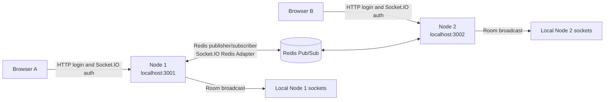
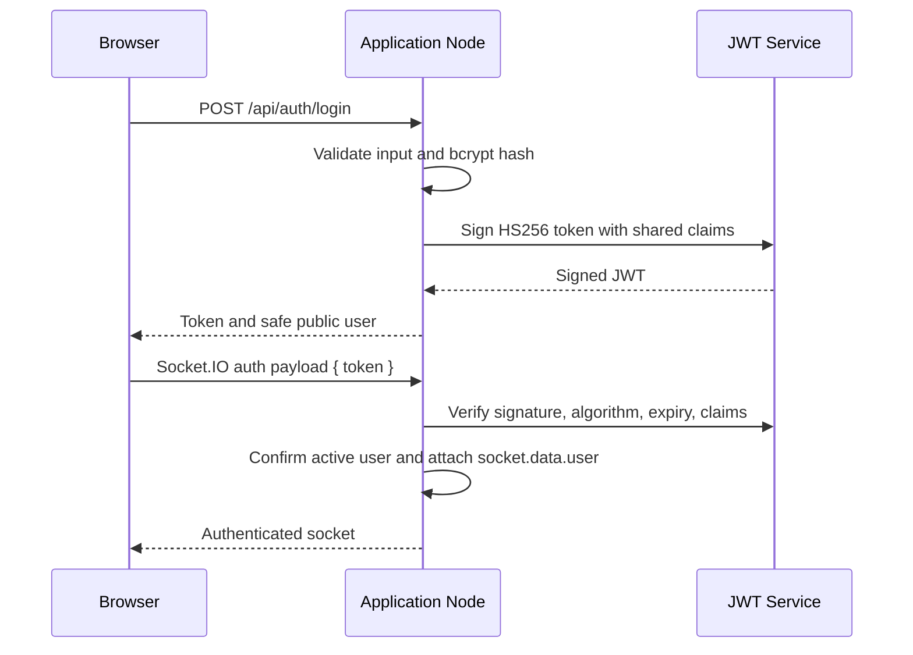
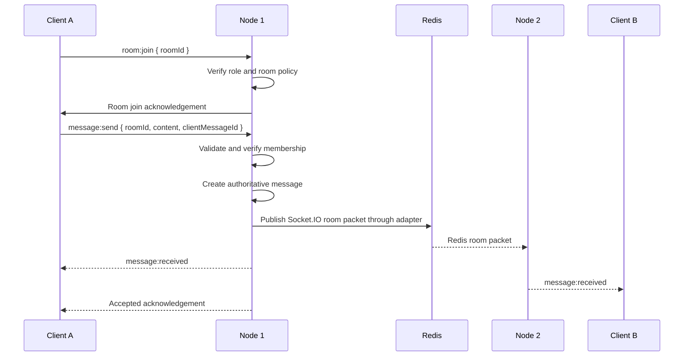

# Distributed Chat Application

A real-time two-node chat application built with React, Express, Socket.IO, JWT, and the Socket.IO Redis Adapter. It intentionally uses no application database; users and message history are in memory.

## How the two nodes are created

There is only one reusable backend implementation in `server/src/`. It is launched twice as two independent operating-system processes. The launcher calls the same `createServer(config)` function in both processes, but passes a node-specific configuration:

```text
Node 1 process                         Node 2 process
-------------------                    -------------------
PORT=3001                              PORT=3002
SERVER_ID=node-1                       SERVER_ID=node-2
Express app                            Express app
HTTP server                            HTTP server
Socket.IO server                       Socket.IO server
In-memory user Map                     In-memory user Map
Room policy                            Room policy
EventEmitter                           EventEmitter
Redis publisher/subscriber             Redis publisher/subscriber
```

The two processes are therefore not two namespaces or two Socket.IO objects inside one Node process. Each process has its own HTTP listener, Socket.IO server, socket connections, room memberships, deduplication cache, EventEmitter, and user Map.

### Which variables are node-specific

| Variable | Node 1 | Node 2 | Purpose |
|---|---:|---:|---|
| `PORT` | `3001` | `3002` | The exact HTTP, polling, and WebSocket listener port |
| `SERVER_ID` | `node-1` | `node-2` | Name used in logs, health responses, and message metadata |

### Which variables are shared

Both nodes must receive exactly the same values for these variables:

| Variable | Example | Purpose |
|---|---|---|
| `JWT_SECRET` | A strong development/production secret | Both nodes validate the same JWT |
| `JWT_EXPIRES_IN` | `1h` | Consistent token expiry |
| `REDIS_URL` | `redis://localhost:6379` | Shared Redis infrastructure |
| `CLIENT_ORIGIN` | `http://localhost:5173` | Allowed browser origin |

They must not have different JWT secrets, room policies, or Redis URLs. `JWT_SECRET` is a real secret only in local environment configuration and must never be committed.

### Environment files

Copy the provided examples before configuring real secrets:

```powershell
Copy-Item .env.node1.example .env.node1
Copy-Item .env.node2.example .env.node2
```

Use `.env.node1` for Node 1 and `.env.node2` for Node 2. Both files should contain the same shared values. Only `PORT` and `SERVER_ID` should differ:

```env
# .env.node1
PORT=3001
SERVER_ID=node-1
JWT_SECRET=replace-with-a-long-random-secret
JWT_EXPIRES_IN=1h
REDIS_URL=redis://localhost:6379
CLIENT_ORIGIN=http://localhost:5173
```

```env
# .env.node2
PORT=3002
SERVER_ID=node-2
JWT_SECRET=replace-with-a-long-random-secret
JWT_EXPIRES_IN=1h
REDIS_URL=redis://localhost:6379
CLIENT_ORIGIN=http://localhost:5173
```

The root `dev:node1` and `dev:node2` scripts set `NODE_ENV_FILE` and the backend loads the matching file before configuration validation:

```powershell
npm run dev:node1
npm run dev:node2
```

The resulting server bootstrap flow is:

```text
dev:node1 -> NODE_ENV_FILE=../.env.node1
             -> loadEnvironmentFile() in server/src/config/env.js
             -> loadConfig() in server/src/createServer.js

dev:node2 -> NODE_ENV_FILE=../.env.node2
             -> loadEnvironmentFile() in server/src/config/env.js
             -> loadConfig() in server/src/createServer.js
```

Node 1 therefore reads `PORT=3001` while Node 2 reads `PORT=3002`. Do not configure one single `.env` file with only one port for both processes.

## System design



Startup is ordered as follows:

1. Validate required process configuration.
2. Create the Express app and HTTP server.
3. Create the Socket.IO server.
4. Connect a Redis publisher and a duplicated Redis subscriber.
5. Install the Socket.IO Redis Adapter.
6. Register authentication and room/message handlers once.
7. Listen on the node-specific port.
8. Return ready only while Redis is connected.

### Login and authentication flow



### Room and message flow



There is no HTTP peer relay and no application database. Redis exists only as the cross-node messaging infrastructure.

## Start

Prerequisites: Node.js 20+, npm, and Docker Desktop or Redis for Windows.

```powershell
npm run install:all
npm run start:redis
npm run dev
```

Startup should now make progress within a few seconds. Each backend first prints
`[startup] Loading node environment configuration...`, then
`[startup] Connecting node=...`, then Redis connection status. Redis is mandatory
before a node can accept chat traffic, so if Redis is unavailable startup ends
quickly with `Startup failed` instead of leaving a node running indefinitely.

Open `http://localhost:5173`. This starts Node 1, Node 2, and React as separate visible processes.

Alternative processes:

```powershell
npm run dev:node1
npm run dev:node2
npm run dev:client
```

### Start Redis without Docker

WSL is already available on many Windows development machines. Install and start Redis in Ubuntu with:

```powershell
npm run start:redis:wsl
npm run status:redis:wsl
```

`status:redis:wsl` should print `PONG`. Redis listens on `localhost:6379` through the
default WSL networking configuration, matching the node environment files.

Do not use Docker Desktop as a mandatory dependency when WSL Redis is available.
To stop Redis inside WSL:

```powershell
wsl -d Ubuntu -u root redis-cli shutdown
```

### Development without Redis

Redis is still retained as required infrastructure. If Redis is temporarily
unavailable, each backend can start in degraded HTTP/UI development mode:

- Login and health liveness remain available.
- `/health/ready` returns HTTP 503 and `redis: disconnected`.
- Socket.IO same-node local chat may continue to work.
- Cross-node Redis Adapter delivery is unavailable.
- The React connection indicator shows `degraded` rather than `connected`.

The node does not claim distributed readiness while Redis is disconnected.

## Demo accounts

All demo accounts use the password `demo-password`:

| Username | Role | Rooms |
|---|---|---|
| alice | member | general, engineering |
| bob | member | general, engineering |
| mod | moderator | general, engineering, moderators |
| admin | admin | all rooms |

## URLs

- React: http://localhost:5173
- Node 1: http://localhost:3001
- Node 2: http://localhost:3002
- Health: `/health/live` and `/health/ready`

## Failover demonstration

1. Start Redis and both nodes, then sign in in two browser sessions.
2. Join `general` on both clients.
3. Stop Node 1 with Ctrl+C.
4. The original Node 1 client displays reconnecting, connects to Node 2, verifies the existing JWT, and restores rooms without a browser refresh.
5. Restart Node 1; the client remains on Node 2 instead of switching back.

Socket.IO authentication uses the browser-compatible `auth: { token }` payload. A browser WebSocket does not allow arbitrary bearer headers, so this implementation does not claim Authorization-header WebSocket authentication.

## Tests

```powershell
npm test
npm --prefix client run build
```

Integration tests require Redis and both running application nodes. `/health/ready` must report 200 before demonstrating distributed delivery.

## Limitations

- Users are process-local seeded Maps.
- No message history persists after restart.
- Redis outages prevent cross-node delivery and are reported by readiness.
- Deduplication is bounded and process-local.
- Failover does not migrate existing socket sessions and may lose unacknowledged messages.
